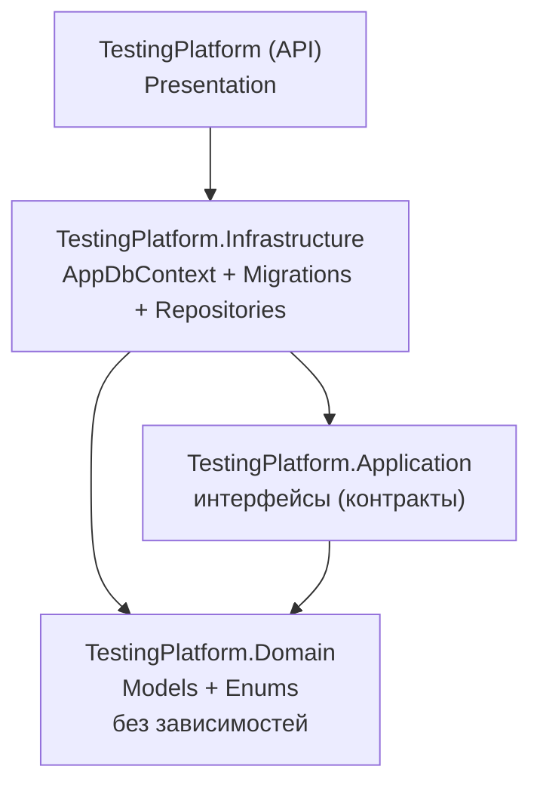

# Архитектура решения TestingPlatform

## Структура

```
TestingPlatform/                        <- корень решения
├── TestingPlatform.slnx                <- решение (.NET 10 — формат slnx)
├── TestingPlatform/                    <- Presentation Layer (API)
│   ├── Controllers/                    <- код временно закомментирован
│   ├── Program.cs                      <- DI, Swagger, применение миграций
│   ├── appsettings.json                <- строка подключения (Data Source=testing.db)
│   └── TestingPlatform.csproj          <- Sdk="Microsoft.NET.Sdk.Web"
├── TestingPlatform.Domain/             <- ядро: модели и перечисления, без зависимостей
│   ├── Models/                         <- User, Student, Group, Test, Question, ...
│   ├── Enums/                          <- UserRole, TestType, AnswerType
│   └── TestingPlatform.Domain.csproj
├── TestingPlatform.Application/        <- контракты (интерфейсы)
│   ├── Interfaces/IGroupRepository.cs
│   └── TestingPlatform.Application.csproj
└── TestingPlatform.Infrastructure/     <- доступ к данным
    ├── Data/AppDbContext.cs            <- namespace TestingPlatform.Infrastructure
    ├── Repositories/GroupRepository.cs
    ├── Migrations/                     <- миграции живут здесь
    └── TestingPlatform.Infrastructure.csproj
```

## Схема связей проектов



Текстом то же самое:

```
API ──► Infrastructure ──► Application ──► Domain
             └────────────────────────────► Domain
```

Правило направленности: зависимости идут **внутрь** — Domain ни от кого не зависит; Infrastructure знает про Domain и Application; API знает только про Infrastructure (Domain подтягивается транзитивно).

## Пакеты

| Проект | NuGet |
|---|---|
| TestingPlatform (API) | Microsoft.AspNetCore.OpenApi, Swashbuckle.AspNetCore, Microsoft.EntityFrameworkCore.Design |
| TestingPlatform.Infrastructure | Microsoft.EntityFrameworkCore, Microsoft.EntityFrameworkCore.Relational, Microsoft.EntityFrameworkCore.Sqlite |
| Domain / Application | нет пакетов |

## Команды

```bash
# сборка всего решения
dotnet build TestingPlatform.slnx

# миграция (создаётся в Infrastructure, стартовый проект — API)
dotnet ef migrations add --project TestingPlatform.Infrastructure/TestingPlatform.Infrastructure.csproj \
    --startup-project TestingPlatform/TestingPlatform.csproj \
    --context TestingPlatform.Infrastructure.AppDbContext Initial

# применить миграции
dotnet ef database update --project TestingPlatform.Infrastructure/TestingPlatform.Infrastructure.csproj \
    --startup-project TestingPlatform/TestingPlatform.csproj

# запуск (база testing.db создастся в папке API)
cd TestingPlatform && dotnet run
```

Если `dotnet ef` не найден, добавь инструмент в PATH текущего окна PowerShell:
```powershell
$env:Path += ";$env:USERPROFILE\.dotnet\tools"
```

## Как показать схему в IDE

**Rider:** ПКМ по решению → Tools → Show Project Diagram.

**Visual Studio:** Extensions → Manage Extensions → установить NDepend (пробная версия 14 дней) → Analyze 4 .NET Assemblies → Build Graph.

Без сторонних расширений в VS: ПКМ по решению → «Схема зависимостей проекта» (Project Dependency Diagram) — доступна в некоторых редакциях; либо ориентироваться на таблицу ссылок выше, она ровно соответствует реальным ссылкам в csproj.
